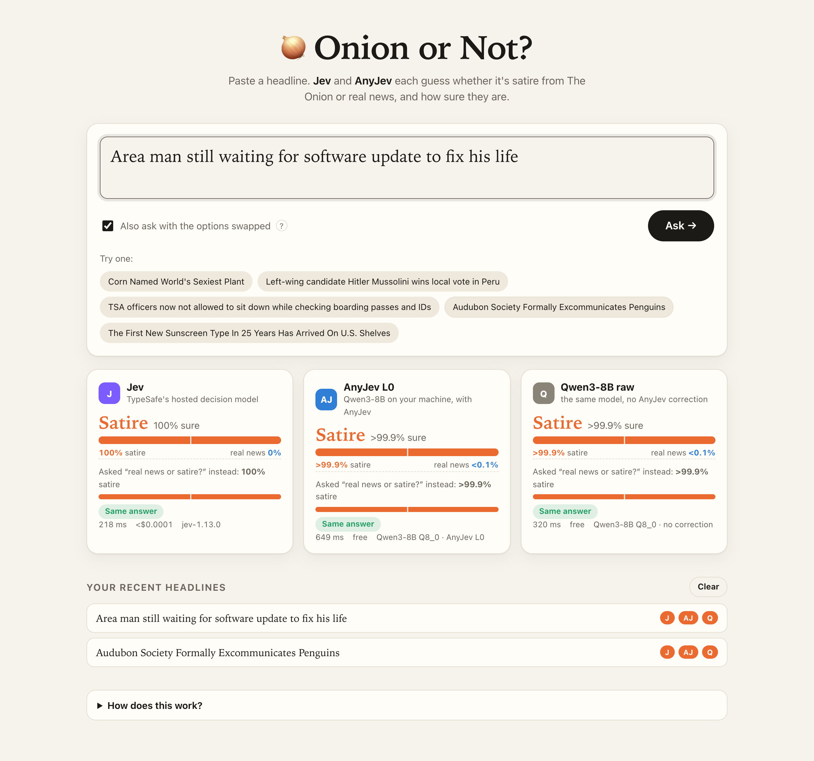

# 🧅 Onion or Not?

**Is this headline satire from The Onion, or real news?** Type any headline and three models answer side
by side, each with how sure it is:

| | What it is | Where it runs |
|---|---|---|
| **Jev** | [TypeSafe](https://typesafe.ai)'s hosted decision model | TypeSafe's API, with your own API key |
| **AnyJev L0** | Qwen3-8B, read out by [AnyJev](https://github.com/nokia-applied-research/AnyJev) at level L0 | your computer (llama.cpp) |
| **Qwen3-8B raw** | the same open model with no AnyJev correction, for comparison | your computer (llama.cpp) |

Tick **"Also ask with the options swapped"** to ask *"real news or satire?"* as well as *"satire or real
news?"*. A plain LLM sometimes changes its answer just because the options came in a different order.
AnyJev L0 reads both orders, so its answer can't flip that way.



## Quick start

You need Python 3.10+ and [uv](https://docs.astral.sh/uv/) (or plain `pip`, see below).

```bash
git clone https://github.com/andrisgauracs/onion-or-not.git
cd onion-or-not
uv sync                                  # installs everything into .venv
cp .env.example .env                     # then put your TypeSafe key in .env
uv run onion-or-not download             # the open model, ~5 GB, once
uv run onion-or-not                      # opens http://127.0.0.1:8000
```

Each model works on its own:

- **Jev only:** skip the download. The AnyJev cards then show how to download the model.
- **AnyJev only:** leave `TYPESAFE_API_KEY` empty. The Jev card then shows how to add a key.

### Your TypeSafe API key

Jev runs on TypeSafe's servers, so it needs **your own** API key. Get one at
[typesafe.ai](https://typesafe.ai) and put it in `.env`:

```
TYPESAFE_API_KEY=your-key-here
```

`.env` is in `.gitignore`. Never commit it. A question costs a tiny fraction of a cent: about 300 input
tokens at $0.042 per million, and output is free. The site shows the cost of each answer.

### The open model

`onion-or-not download` fetches the official
[Qwen3-8B GGUF](https://huggingface.co/Qwen/Qwen3-8B-GGUF) from Hugging Face into `models/`:

| `--quant` | Size | Notes |
|---|---|---|
| `Q4_K_M` (default) | ~5.0 GB | runs well on a 16 GB laptop |
| `Q5_K_M` | ~5.9 GB | |
| `Q6_K` | ~6.7 GB | |
| `Q8_0` | ~8.7 GB | closest to the full model |

To use another size, download it with `--quant` and set `ONION_QUANT` in `.env` to match. If you already
have a GGUF of Qwen3-8B, point `ONION_GGUF` at it instead.

The model loads in the background when you open the page. The first question can take a few seconds while
that finishes.

**GPU.** On Apple Silicon, llama.cpp uses Metal automatically. On an NVIDIA GPU, install llama-cpp-python
with CUDA before running the site:

```bash
CMAKE_ARGS="-DGGML_CUDA=on" uv pip install --reinstall --no-cache llama-cpp-python
```

Without a GPU it still works on the CPU, only more slowly. Set `ONION_GPU_LAYERS=0` if GPU offload causes
trouble.

### Without uv

```bash
python -m venv .venv && source .venv/bin/activate
pip install -e .
onion-or-not download
onion-or-not
```

## Settings (`.env`)

| Variable | Default | |
|---|---|---|
| `TYPESAFE_API_KEY` | — | your TypeSafe key, needed for Jev |
| `JEV_MODEL` | `jev-1.13.0` | which Jev version to ask |
| `ONION_QUANT` | `Q4_K_M` | which downloaded GGUF to load |
| `ONION_GGUF` | — | path to a Qwen3-8B GGUF, overrides `ONION_QUANT` |
| `ONION_GPU_LAYERS` | `-1` | layers on the GPU (`-1` all, `0` CPU only) |
| `HOST` / `PORT` | `127.0.0.1` / `8000` | where the site listens |

The site listens only on your own machine by default. If you serve it on a network, anyone who can reach
it can spend your TypeSafe credit.

## How it works

Every model gets the same question about the headline text only:

> *Is this headline satire from The Onion, or real news?* Options: `satire`, `real news`

- **Jev:** one call to TypeSafe's `system_one` endpoint through the official
  [`typesafe-sdk`](https://pypi.org/project/typesafe-sdk/), with a `Choice` question. Jev returns a
  probability for each option.
- **AnyJev L0:** AnyJev's `Decider` scores each option from the model's next-token probabilities. It
  reads them in every order of the options, then removes the model's built-in lean toward one option.
  For that it uses a *content-free* prior: the model's answer to the same question with no headline.
  This needs no training and no labels.
- **Qwen3-8B raw:** the same `Decider` at level `raw`. It gives the model's plain probabilities in the
  order asked.

The local server is a small FastAPI app (`onion_or_not/server.py`). The page is plain HTML, CSS and
JavaScript in `onion_or_not/static/`, with no build step.

## Privacy

- **Jev:** headlines you ask Jev about are sent to TypeSafe's API.
- **AnyJev and Qwen3-8B raw:** these never leave your machine.
- **History:** your recent headlines are kept only in your browser's local storage. **Clear** removes them.

## Credits

- [AnyJev](https://github.com/nokia-applied-research/AnyJev) (Apache-2.0), by Jiamu Zhang, Tianze Yang,
  Yucheng Shi and Liang Wu.
- [Qwen3-8B](https://huggingface.co/Qwen/Qwen3-8B) (Apache-2.0), by the Qwen team.
- [Jev](https://typesafe.ai), by TypeSafe.

This project isn't affiliated with TypeSafe, the AnyJev authors, the Qwen team or The Onion. "Jev" is
TypeSafe's name for their model.

## License

MIT. See [LICENSE](LICENSE).
